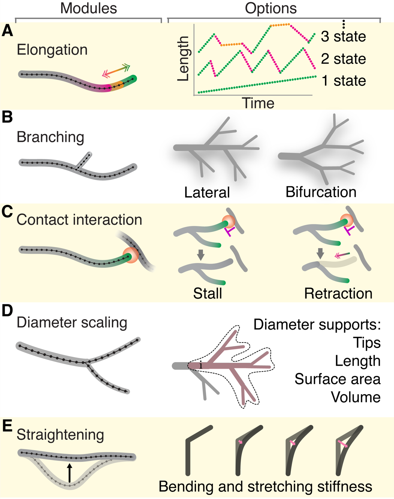
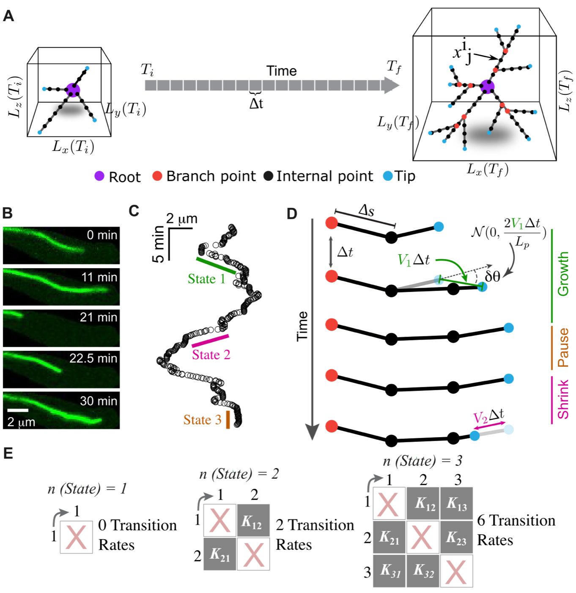
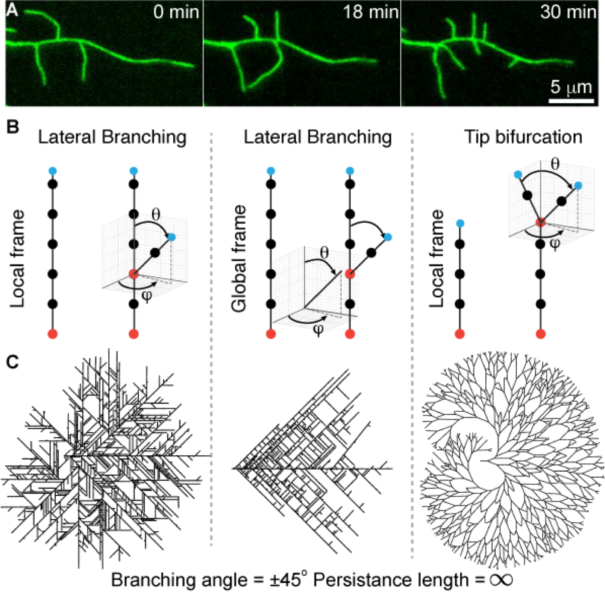
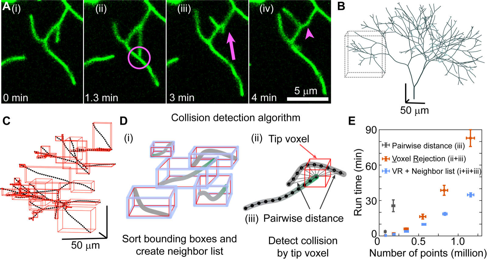
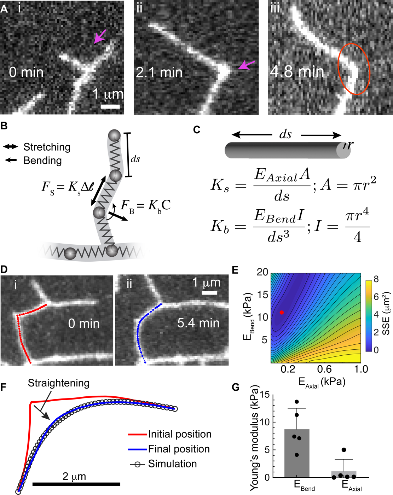
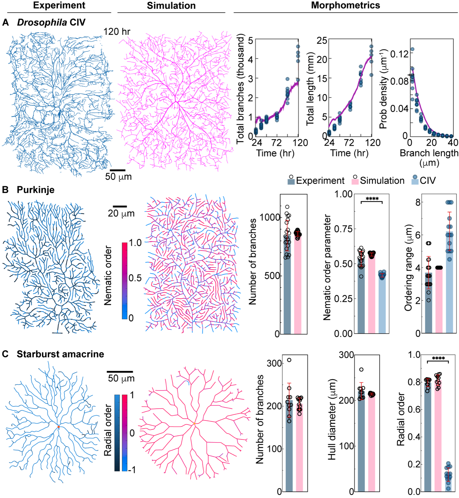
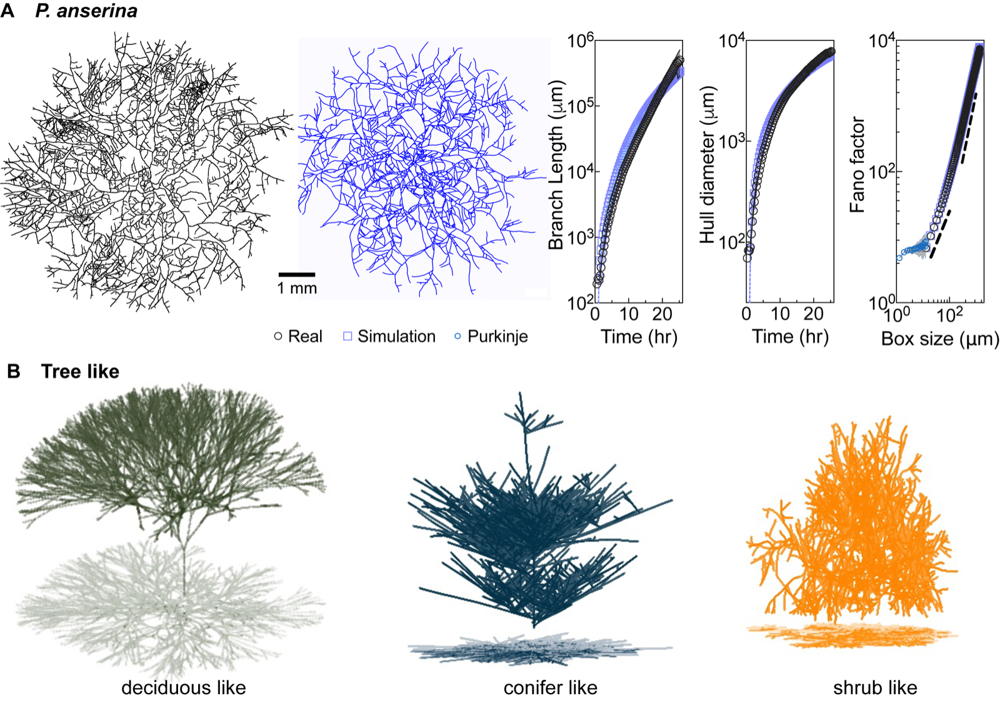

<p align="center"></p>

# BranchMorphoGen User Manual

**BranchMorphoGen: a generalized framework to simulate branching morphogenesis**
Sabyasachi Sutradhar, Sonal Shree, Jonathon Howard (Howard Lab, Yale University)

Version 1.0.0 · MIT License

---

## Contents

1. [What BranchMorphoGen is](#1-what-branchmorphogen-is)
2. [Installation](#2-installation)
3. [Quick start](#3-quick-start)
4. [The model](#4-the-model)
5. [The parameter file](#5-the-parameter-file)
6. [Parameter reference](#6-parameter-reference)
7. [Output files](#7-output-files)
8. [Worked examples](#8-worked-examples)
9. [The web GUI](#9-the-web-gui)
10. [Web GUI development](#10-web-gui-development)
11. [Troubleshooting](#11-troubleshooting)
12. [Citing BranchMorphoGen](#12-citing-branchmorphogen)
13. [Acknowledgements](#13-acknowledgements)

---

## 1. What BranchMorphoGen is

Many structures in nature branch, at very different length and time scales. Examples include rivers, trees, fungal hyphae, lungs, kidneys and neurons. In neurons, a cell's shape sets how it connects to other cells and how it works. Many molecules are known to change neuronal shape. How their activity turns into a whole branched tree is still not well understood.

BranchMorphoGen is a fast C++ simulator for branched morphologies. It is agent-based: every branch tip acts on its own, following a few local growth rules. The whole tree comes out of those rules. You don't give it a template.

The simulator combines five local processes. You can switch each one on or off and tune it:

| Module | What it does | Options |
|---|---|---|
| **Elongation** | Tips grow, pause and shrink | 1, 2, 3 or more tip states with time-dependent velocities and switching rates |
| **Branching** | New branches appear as a random (Poisson) process | Lateral branching or tip bifurcation; local or global angle frame |
| **Contact interaction** | Tips avoid other branches | After a collision the tip stalls or retracts, set by its own state model |
| **Diameter scaling** | Branch radius depends on the subtree it supports | Number of tips, number of branches, length, surface area or volume |
| **Straightening** | Branches act as elastic rods that resist stretching and bending | Axial and bending Young's moduli, drag |


*Figure 1. The five modules (left) and their options (right). (A) Elongation with 1, 2 or 3 tip states. (B) Lateral branching and bifurcation. (C) Contact interaction: a tip that touches another branch either stalls or retracts. (D) Diameter scaling: a branch's diameter depends on its subtree (tips, length, surface area or volume). (E) Straightening by bending and stretching stiffness.*

With these modules BranchMorphoGen reproduces the measured growth of *Drosophila* Class IV dendritic arborization (da) neurons. It also produces Purkinje cells, retinal ganglion cells and starburst amacrine cells, plus non-neuronal networks such as fungal mycelia and tree-like shapes. It runs a large parameter set in minutes, so you can scan a large parameter space. You can also ask how a change at the molecular level, such as an altered tip-switching rate, alters the shape of the whole tree.

For every frame it writes three outputs:
- the morphology as **SWC** files
- per-branch statistics as **CSV** files
- **synthetic microscopy images** as TIFF files

You can use these for analysis, for testing image-processing pipelines, or as training data for machine learning.

---

## 2. Installation

### 2.1 Prerequisites

| Requirement | Notes |
|---|---|
| CMake ≥ 3.16 | |
| C++17 compiler | g++ or clang++ |
| libtiff (development headers) | Used to write the synthetic images |
| POSIX threads | Used when `RunParallel=true`; included with Linux and macOS |
| Python ≥ 3.8 | **Only** for the optional web GUI. It needs no extra packages. |

Eigen ships with the repository in `third_party/eigen`.

### 2.2 Install libtiff

```bash
# Ubuntu / Debian
sudo apt-get install libtiff-dev

# macOS (Homebrew)
brew install libtiff
```

If libtiff is installed somewhere non-standard, point CMake at it:

```bash
export TIFF_ROOT=/path/to/tiff        # must contain include/tiff.h and lib/libtiff.*
```

### 2.3 Build

```bash
git clone https://github.com/SabyasachiSutradhar/BranchMorphoGen.git
cd BranchMorphoGen
mkdir build && cd build
cmake ..                 # or: cmake -DTIFF_ROOT=/custom/tiff ..
make -j                  # builds build/BranchMorphoGen
```

`INSTALL.sh` in the repository root runs the same steps.

To rebuild from scratch, run `rm -rf build` and repeat the steps above.

### 2.4 Check the build

```bash
./BranchMorphoGen --about        # prints version and build date
```

---

## 3. Quick start

```bash
cd build
./BranchMorphoGen ../parameters.in
```

The simulator writes all output into the **current working directory**, and every file name starts with `SimulationName`. A good habit is to give each run its own folder:

```bash
mkdir -p runs/test1 && cd runs/test1
/path/to/build/BranchMorphoGen /path/to/parameters.in
```

The `parameters.in` that ships with the repository is a 2-D *Drosophila* Class IV neuron. It runs from 960 min to 7200 min (16 h to 120 h after egg laying) and writes 11 frames.

If you would rather edit parameters in a form and watch the neuron grow, use the [web GUI](#9-the-web-gui).

---

## 4. The model

### 4.1 Geometry and representation


*Figure 2. (A) The simulation box grows from L(Tᵢ) to L(T_f). Points are coloured as root, branch points, internal points and tips. (B–C) A real dendrite tip switching between growth, pause and shrinkage. (D) How one time step changes a tip. (E) An n-state model needs n(n−1) transition rates.*

- **Points.** Each branch is a chain of points spaced `BranchInterval` apart. Every point except the root has exactly one parent.
- **Point types.** A point with one child is an *internal* point. A point with two children is a *branch point*. A point with no children is a *tip*.
- **Branch types.** A branch that ends in a tip is a *terminal* branch. All other branches are *internal* branches.
- **Root.** The root (soma) does not move and has radius `RadiusSoma`.
- **Which branches change.** Only terminal branches change state and grow or shrink.
- **Boundary.** The simulation lives in a box set by `LimitsX/Y/Z`. These limits can change with time, so the box can grow along with the animal. `Boundary_SoftLength` sets the width of a soft margin at the edge of the box.

### 4.2 Tip dynamics (elongation)

Each terminal branch is a **continuous-time Markov process** over the discrete states in `States`. Each state has its own velocity, given in `StateVelocity`. A typical choice is three states:
- growth (+1)
- pause (0)
- shrinkage (−1)

You also give the transition-rate matrix **K** (`TransitionRates`). It has zero diagonal, and `K[i][j]` is the rate of switching from state *i* to state *j*.

At every step, for a tip in state *i*:

1. Compute the total escape rate, k_tot = Σⱼ K[i][j].
2. A transition happens with probability P = 1 − exp(−k_tot Δt).
3. If it does, the new state *j* is picked with probability K[i][j] / k_tot. The tip then takes that state's velocity.

If there is only one state, the switching step is skipped and tips grow at a constant velocity.

**Growth.** The length change is Δl = v Δt.
- **Δl > 0:** new points are added along the current direction plus a random sideways kick. The kick is drawn from a normal distribution with variance 2vΔt / L_p, where L_p is `PersistanceLength`. Use `inf` to get perfectly straight growth.
- **Δl < 0:** the branch is cut back by |Δl|.
  - If a non-initial branch shrinks to nothing, it is removed.
  - With probability `RebranchingProb` it regrows instead of being removed.
  - Initial branches always regrow.

`StateVelocity`, `TransitionRates`, `BranchingRate` and the box limits can all be **time-dependent** (see [§5.2](#52-time-dependent-parameters)). This lets you fit growth rules that change during development.

### 4.3 Branching


*Figure 3. (A) A new lateral branch forming in a Class IV neuron. (B) Lateral branching in the local and global frames, and tip bifurcation. θ is the polar angle and φ the azimuthal angle. (C) Example trees from each mode with ±45° angles and infinite persistence length.*

New branches form as a Poisson process. Per time step, a branch spawns a new branch with probability:

- P_b = 1 − exp(−K_b Δt), or
- P_b = 1 − exp(−K_b L Δt) if `LengthDependentBranching=true`. Here L is the branch length, so longer branches branch more often.

K_b is `BranchingRate`. Because branching is random, BranchMorphoGen does not produce highly stereotyped patterns, such as those of lung or kidney.

- **Lateral branching** (`Bifurcation=false`): a new branch of length `NascentBranchLength` starts at a random point along an existing branch.
- **Bifurcation** (`Bifurcation=true`): the tip splits into two daughter branches. `BifurcationRatio` sets how symmetric the split is:
  - 1 means fully symmetric.
  - 0 means fully asymmetric.

**Angles.** The direction of a new branch uses two angles. The *azimuthal* angle φ is the branching angle in 2-D. The *polar* angle θ is the bifurcation angle, and the out-of-plane angle in 3-D.
- `BranchingAngleRef=local` measures the angles from the parent's local direction.
- `BranchingAngleRef=global` measures them from the fixed x/z axes.

Each angle has its own mode:

| Mode | Behaviour |
|---|---|
| `fixed` | Angle drawn from N(mean, `BranchingAngleSTD`), always on the same side |
| `reflective` | Same distribution, but the side (±) is chosen at random |
| `uniform` | Uniformly random (φ ∈ [0, 2π), θ ∈ [0, π)) |

For Class IV neurons the measured branching angle is about 90° ± 26°.

### 4.4 Contact interaction (self-avoidance)


*Figure 4. (A) A growing tip touches a neighbouring branch (circle), then retracts (arrow). (B–C) Each branch has a bounding box. (D) The three-stage collision search. (E) Run time against tree size for the three search strategies.*

When `SelfAvoiding=true`, a tip that comes within `Interaction_Threshold` of another branch is treated as having **collided**. For the next `PostCollisionPeriod`:
- The tip follows its own **collision** state model: `Collision_States`, `Collision_StateVelocity` and `Collision_TransitionRates`. This lets you model either response:
  - **stall:** mostly the pause state
  - **retraction:** mostly the shrink state
- After the period ends, the tip goes back to the first state at the current growth velocity.
- If `FreezeCollidedBranch=true`, a branch that collided cannot spawn new branches.

Checking every pair of points would cost O(N²). Instead, BranchMorphoGen uses a three-stage search:

1. **Neighbour list.** Every branch has a padded bounding box. The boxes are sorted along the longest axis, which allows quick range queries. The list is rebuilt every few steps; the interval is set automatically from the maximum tip speed and the padding.
2. **Tip-voxel rejection.** Only branches whose boxes overlap the growing tip's voxel are kept.
3. **Pairwise distance.** Exact point distances are computed only for that short list.

On trees with about a million points, this is several times faster than pairwise checks alone (Fig. 4E).

### 4.5 Diameter scaling

The radius of a branch depends on a quantity Q taken from its subtree:

  r = min( √( r_min² + β Q / π ), r_max )

Here r_min is `MinimumRadius`, r_max is `MaximumRadius` and β is `BetaRadius`. `RadiusModel` chooses Q:

| `RadiusModel` | Q (summed over the branch's subtree) |
|---|---|
| `None` | constant: every branch gets r_min |
| `TipNumber` | number of tips |
| `BranchNumber` | number of branches |
| `Length` | total length |
| `Area` | total surface area |
| `Volume` | total volume |

For *Drosophila* Class IV neurons, a branch's cross-sectional area grows with the number of tips it supports, so use `TipNumber`. This range of models covers the classical scaling laws, such as Rall's, da Vinci's and Murray's laws.

### 4.6 Branch straightening (mechanics)


*Figure 5. (A) A real branch straightening after a neighbour retracts. (B–C) The bead–spring model and its stiffness formulas. (D–F) Fitting simulated straightening to a measured branch. (G) Fitted bending and axial Young's moduli.*

Branching and retraction together can leave sharp kinks, which real neurons don't show. When `StraightenBranches=true`, every branch is treated as a chain of beads joined by elastic segments, each of length ds = `BranchInterval` and radius r:

- **Stretching stiffness:** K_s = E_axial · A / ds, where A = πr²
- **Bending stiffness:** K_b = E_bend · I / ds³, where I = πr⁴/4

The beads move with overdamped dynamics. Their drag is ζ = 4π · ds · `DragCoef`. Forces are updated about once per unit time, not every step, to save time.

Because the stiffness depends on r, thick primary branches straighten more than thin terminal ones. The paper shows that this coupling between straightening and diameter is what gives rise to the primary/secondary/higher-order hierarchy of branches.

Fitting real straightening events (Fig. 5E–G) gives E_bend of about 9 kPa and E_axial of about 1 kPa.

### 4.7 Initial configuration

You can start a simulation in two ways:

- **From scratch.** `N_BranchInitial` branches leave the soma at `Root`. Each starts with length `InitialLength`, in-plane angle `InitialAngle` and out-of-plane angle `InitialAngleWithZ`.
  - `N_BranchInitial` accepts a range such as `2-4`. Each sample then draws a number from that range.
  - A negative `InitialAngle` picks a random orientation.
- **From SWC** (`ReadFromSWC=true`). The initial tree is read from `SWCFileName`.
  - If that is a **folder**, every `.swc` file in it is simulated as its own sample.
  - In that case `NSample` is set to the number of files.

Branches shorter than the soma radius are reset to the default growing state, so growth near the soma starts without collisions.

### 4.8 Randomness and reproducibility

The random seed is fixed: `GLOBAL_SEED = 65` in `src/main.cpp`, and sample *i* uses seed 65 + *i*. Identical parameter files therefore give identical morphologies. For a different set of random trees, either raise `NSample` or change `GLOBAL_SEED` and rebuild.

---

## 5. The parameter file

### 5.1 Syntax

- One `Key = value;` per line. Spaces around `=` are ignored.
- **Do not rename keys.** An unknown key prints `Warning: Unknown key '…'` and is ignored.
- Comments start with `//`, `#` or `%`.
- Vectors are separated by commas: `States = 1,0,-1;`
- Matrices use `;` between rows and `,` between columns: `0,0.69,0.51; 0.42,0,0.30; 0.67,0.71,0`
- Booleans: `true` / `false`.
- `inf` is accepted for `PersistanceLength` and `PostCollisionPeriod`.
- Keep units consistent. All lengths are in `SpatialUnit` (default micron) and all times in `TemporalUnit` (default min).

### 5.2 Time-dependent parameters

`LimitsX`, `LimitsY`, `LimitsZ`, `StateVelocity`, `TransitionRates` and `BranchingRate` accept either a constant or a `time : value` table. Between the listed times the values are linearly interpolated:

```text
BranchingRate =
960:0.01906;
1440:0.00954;
2880:0.00191;
7200:0.00114;

LimitsX=
960:-40.0,40.0;
5760:-175.0,175.0;
7200:-175.0,175.0;

LimitsZ=-10,10;          // constant
```

A table can also use `inf` / `-inf` as times. Within one parameter, use either a constant or a table, not both.

---

## 6. Parameter reference

The defaults in the "Example" column come from `parameters.in` (*Drosophila* Class IV).

### Simulation geometry and time
| Key | Example | Meaning |
|---|---|---|
| `SimulationName` | `xx` | Prefix for every output file |
| `SpatialUnit` / `TemporalUnit` | `micron` / `min` | Unit labels written into the outputs |
| `NSample` | `1` | Number of independent samples |
| `RunParallel` | `false` | Run samples in parallel threads (needs `NSample > 1`) |
| `Dimension` | `2` | `2` or `3` |
| `Dt` | `0.025` | Time step |
| `Time_Start`, `Time_End` | `960`, `7200` | Start and end time |

### Initial configuration
| Key | Example | Meaning |
|---|---|---|
| `ReadFromSWC` | `false` | Start from an SWC file or folder |
| `SWCFileName` | `INPUT2.swc` | `.swc` file, or a folder of `.swc` files |
| `Root` | `0,0,0` | Soma position |
| `N_BranchInitial` | `2-4` | Number of primary branches (a single number or a range) |
| `InitialLength` | `15` | Length of the primary branches |
| `InitialAngle` | `90` | In-plane angle of the first branch, in degrees; negative means random |
| `InitialAngleWithZ` | `0` | Angle with the z-axis, in degrees |
| `RadiusSoma` | `5` | Soma radius |
| `NascentBranchLength` | `0.6` | Starting length of a new branch |
| `BranchInterval` | `0.1` | Spacing between points (segment length ds) |
| `PersistanceLength` | `100` | Directional persistence L_p; `inf` gives straight growth |

### Boundary
| Key | Example | Meaning |
|---|---|---|
| `LimitsX/Y/Z` | see file | `min,max` of the box, can change with time |
| `Boundary_SoftLength` | `15` | Width of the soft margin at the edge of the box |

### Tip states
| Key | Example | Meaning |
|---|---|---|
| `States` | `1,0,-1` | State labels (growth, pause, shrinkage) |
| `StateVelocity` | `1.54,0,-1.63` | Velocity of each state; the count must match `States`; can change with time |
| `TransitionRates` | 3×3 matrix | Switching rates; NState × NState with zero diagonal; can change with time |

### Branching
| Key | Example | Meaning |
|---|---|---|
| `Bifurcation` | `false` | `true` = tip bifurcation, `false` = lateral branching |
| `BifurcationRatio` | `1.0` | Symmetry of the split (1 = symmetric, 0 = asymmetric) |
| `BranchingAngleRef` | `local` | `local` or `global` frame |
| `PolarAngleMode` / `AzimuthalAngleMode` | `reflective` | `fixed` / `uniform` / `reflective` |
| `PolarBranchingAngle` | `30` | Mean polar (bifurcation) angle, in degrees |
| `AzimuthalBranchingAngle` | `90` | Mean azimuthal angle, in degrees (the branching angle in 2-D) |
| `BranchingAngleSTD` | `30` | Standard deviation of the angle noise, in degrees (0 = no noise) |
| `LengthDependentBranching` | `true` | Scale the branching probability by branch length |
| `BranchingRate` | table | K_b per unit time (per unit length if length-dependent) |
| `RebranchingProb` | `0.2` | Probability that a fully retracted branch regrows instead of being removed |
| `TerminationRate` | `0.0` | Rate at which a tip stops being dynamic for good |

### Collision
| Key | Example | Meaning |
|---|---|---|
| `SelfAvoiding` | `true` | Turn contact interaction on |
| `Interaction_Threshold` | `0.2` | Contact distance |
| `FreezeCollidedBranch` | `false` | Branches that collided cannot spawn new branches |
| `Collision_States` | `1,0,-1` | States used after a collision |
| `Collision_StateVelocity` | `1.69,0,-1.1` | Their velocities |
| `Collision_TransitionRates` | 3×3 matrix | Their switching rates |
| `PostCollisionPeriod` | `1000` | How long the collision model stays active (`inf` allowed) |

### Mechanics
| Key | Example | Meaning |
|---|---|---|
| `StraightenBranches` | `true` | Turn on elastic straightening |
| `E_Axial` | `10` | Axial Young's modulus |
| `E_Bending` | `7500` | Bending Young's modulus |
| `DragCoef` | `0.6` | Viscous drag coefficient |

### Radius
| Key | Example | Meaning |
|---|---|---|
| `MinimumRadius`, `MaximumRadius` | `0.1`, `0.4` | Radius limits |
| `RadiusModel` | `TipNumber` | `None` / `TipNumber` / `BranchNumber` / `Length` / `Area` / `Volume` |
| `BetaRadius` | `0.00135` | β in the radius law |

### Output
| Key | Example | Meaning |
|---|---|---|
| `N_SWC` | `11` | Number of frames, spaced evenly from start to end |
| `MAX_IMAGE_SIZE` | `500` | Image field of view in spatial units (`-1` uses the box limits) |
| `ImagePlane` | `xy` | `xy` / `xz` / `yz` (always `xy` in 2-D) |
| `pixelsize` | `0.1615` | Pixel size in spatial units |
| `SignalMean`, `SignalStd` | `200`, `20` | Intensity of the neuron in the synthetic image |
| `BackgroundMean`, `BackgroundStd` | `9`, `2.5` | Background noise of the synthetic image |

> **Note.** `ClassIV_parameters.in` still uses older names for the mechanics keys: `KSpring`, `KBending` and `Eta`. The current parser ignores them with a warning, and that file also leaves out `Boundary_SoftLength` and `MaximumRadius`. Before using it, replace those three keys with `E_Axial`, `E_Bending` and `DragCoef`, and add the two missing keys. Copy the values from `parameters.in`.

---

## 7. Output files

All files go into the working directory. In the names below, `<name>` is `SimulationName`, `<s>` is the sample index (starting at 1) and `<t>` is the simulation time.

| File | Contents |
|---|---|
| `<name>-Conf-<s>-time-<t>.swc` | Morphology in standard SWC format: `ID Type x y z radius ParentID`. The root has ID 1 and type 1; neurite points have type 4. Opens in neuTube, Vaa3D, NEURON, the TREES toolbox, NeuroM and similar tools. |
| `<name>-Conf-<s>-time-<t>.tif` | Synthetic fluorescence image of the same frame: signal on Gaussian background noise, using `pixelsize` and `ImagePlane`. |
| `<name>-BranchStats-<s>-time-<t>.csv` | One row per branch: `ID, Dynamic Type, State, Length, Radius, Parent ID, Child1 ID, Child2 ID`. |
| `<name>-TemproralProps-<s>.csv` | Time series of the whole tree: time, number of branches, number of tips, total length, average branch length. *(The misspelling "Temproral" is in the actual file name.)* |
| `<name>-RunTime.log` | Wall-clock time per sample. |

Header lines in every file start with `#` and record the simulation name and units.

---

## 8. Worked examples

### 8.1 *Drosophila* Class IV da neuron (the default `parameters.in`)


*Figure 6. Experiment (left), simulation (middle) and morphometrics (right). (A) Drosophila Class IV at 120 h: the total number of branches, total length and branch-length distribution match the measurements across development. (B) Purkinje cell: number of branches, nematic order and ordering range. (C) Starburst amacrine cell: number of branches, hull diameter and radial order.*

The defaults use values measured in Class IV neurons:
- 3-state tip dynamics with time-dependent velocities and rates
- length-dependent lateral branching at about 90°, with the rate falling over development
- collision-triggered retraction
- `TipNumber` diameter scaling
- straightening

The box grows from 80×120 µm at 16 h to 350×450 µm at 96 h, following the growth of the larval body wall.

### 8.2 Choosing parameters for other cell types

| Target | Main settings |
|---|---|
| **Purkinje-like** (planar, nematic order) | `BranchingAngleRef=global`; azimuthal angle near 90° with `fixed`/`reflective` mode; strong self-avoidance; a narrow `LimitsZ`; the root at the bottom edge |
| **Starburst amacrine** (radial) | `Bifurcation=true`; `local` frame; long `PersistanceLength`; a circular field filled from a central soma |
| **3-D trees** (deciduous, conifer or shrub) | `Dimension=3`; `ImagePlane=xz` for side views; vary `PolarBranchingAngle` and `PersistanceLength` |
| **Fungal mycelium** (*P. anserina*) | a single always-growing state; high `PersistanceLength`; `SelfAvoiding=false`; mm-scale limits |


*Figure 7. (A) Podospora anserina mycelium compared with simulation: total branch length, hull diameter and Fano factor. (B) 3-D tree-like shapes (deciduous, conifer and shrub) from changing the angle and persistence parameters.*

### 8.3 Scanning parameters in batches

Each run is a single command with no interaction, so it is easy to script:

```bash
for kb in 0.005 0.01 0.02; do
  d=runs/kb_$kb; mkdir -p $d
  sed "s/^\(\s*BranchingRate\s*=\).*/\1 $kb;/" parameters.in > $d/p.in   # constant rate
  (cd $d && ../../build/BranchMorphoGen p.in) &
done; wait
```

Set `NSample > 1` together with `RunParallel=true` to get several random trees per parameter set on several cores.

---

## 9. The web GUI

The web GUI runs in your browser. You edit parameters in a form and watch the morphology grow while the simulation runs. It does **not** change or link against the C++ core. It does three things:

1. Writes your parameters to a normal `parameters.in`.
2. Runs the unmodified `BranchMorphoGen` executable on that file, in a new folder `webgui/runs/<timestamp>-<name>/`.
3. Watches the files the simulator writes (`*-Conf-*.swc`, `*-TemproralProps-*.csv`, `*.tif`) and sends each new one to the browser as it appears.

It uses only the Python standard library, so there is nothing to install.

> The GUI is in the `webgui/` folder, added in commit *"Add live web GUI for BranchMorphoGen (webgui/)"*.

### 9.1 Start

```bash
# build the core once (skip if build/BranchMorphoGen already exists)
mkdir -p build && cd build && cmake .. && make -j && cd ..

# start the GUI from the repository root
python3 webgui/server.py          # opens http://127.0.0.1:8050
```

| Flag | Meaning |
|---|---|
| `--port 9000` | Use a different port |
| `--host 0.0.0.0` | Listen on all interfaces. The default is `127.0.0.1`. |
| `--binary /path/to/BranchMorphoGen` | Use a specific executable |
| `--build` | Build the core with CMake if no executable is found |
| `--no-browser` | Don't open a browser tab |

**Using the GUI on a remote machine.** Leave the default host and forward the port over SSH:

```bash
ssh -L 8050:127.0.0.1:8050 user@cluster
```

Then open http://127.0.0.1:8050 on your own machine.

### 9.2 Using it

- **Parameter panel (left).** Every key from `parameters.in` is listed, grouped as in the file.
  - Values you change are highlighted.
  - Hover over a key name to see its description.
  - **Time-dependent parameters** are edited as `time : value` tables. "Make constant" turns a table into a single value.
  - **Matrices** are typed as rows separated by `;`.
  - **Checks run as you type.** For example, the number of states must equal the number of velocities, and the matrices must be NState × NState.
  - **SWC start.** For `ReadFromSWC`, upload an `.swc` file under `SWCFileName`.
- **Auto-run on change.** About a second after you stop editing, the current run is stopped and a new one starts.
- **Fast preview** is on by default. It changes two values for the run only:
  - `pixelsize` becomes at least 2 µm, so writing the TIFF is quick.
  - `N_SWC` becomes at least 40, so frames arrive often.

  Turn it off for a full-resolution run that uses exactly your values. The values a run actually used are always saved in `runs/<run>/parameters.in`.
- **Viewer.**
  - Scroll to zoom, drag to pan, double-click to fit.
  - In 3-D, drag to rotate and shift-drag to pan.
  - Colour branches by path distance, branch order, radius or depth.
  - The dashed box is the boundary at that frame's time.
  - "Synthetic image" shows the TIFF for the frame.
- **Timeline.**
  - Scrub through frames or press play. The arrow keys and the space bar also work.
  - "Follow live" jumps to each new frame as it arrives.
  - A sample selector appears when `NSample > 1`.
- **Charts.** Number of tips, number of branches and total length against time, read from `TemproralProps-*.csv`.
- **Files / Log / Runs tabs.**
  - **Files:** download the SWC, TIFF and BranchStats files for a frame, and the run's `parameters.in`.
  - **Log:** the simulator's own console output.
  - **Runs:** replay any earlier run, or load its parameters back into the panel.
- **Import / Export .in.** Load any parameter file, or save the panel as one. The preset menu lists the `*.in` files in the repository root.

### 9.3 Notes

- Each displayed frame is thinned to about 0.4 µm point spacing so that big trees draw quickly. Downloaded files are the full-resolution originals.
- Run folders pile up in `webgui/runs/`. You can delete old ones at any time.

---

## 10. Web GUI development

This section is for anyone who wants to change or extend the GUI.

### 10.1 Design goals

- **Leave the C++ core alone.** The GUI is a separate layer that only reads and writes the same files as a command-line user. Anything the GUI can run, you can reproduce on the command line with the saved `parameters.in`.
- **No dependencies.** The server uses only the Python standard library (`http.server`, `subprocess`, `threading`, `zlib`, `struct`). The front end is a single HTML file with plain JavaScript. There is no build step, `pip` or `npm`, so it runs on locked-down clusters.
- **Live feedback.** Results are streamed while the simulation runs; the page does not wait for the run to finish.

### 10.2 Layout

```text
webgui/
├── server.py          # HTTP server, parameter schema, run manager, file watcher (~790 lines)
├── static/index.html  # entire front end: panel, 2-D/3-D viewer, timeline, charts (~720 lines)
├── README.md          # short user guide
└── runs/              # one folder per run (git-ignored)
    └── <YYYYMMDD-HHMMSS>-<name>/
        ├── parameters.in      # the exact file passed to the core
        ├── gui_values.json    # panel state, used to restore "Runs"
        ├── run.log            # simulator stdout/stderr
        └── <name>-Conf-*.swc / *.tif / *-BranchStats-*.csv / *-TemproralProps-*.csv
```

### 10.3 How it works

```text
 browser (index.html)                     server.py                         BranchMorphoGen (C++)
 ───────────────────                      ─────────                         ─────────────────────
 GET  /api/schema   ───────────────────►  parameter groups, types, help
 POST /api/run {values, swc, overrides} ► render .in → runs/<id>/  ──spawn──► ./BranchMorphoGen parameters.in
 GET  /api/events?run=<id>  (SSE) ◄─────  poll the run folder ◄───── writes files ─┘
        events: start · log · frame · stats · done
 GET  /api/image?…   ◄──────────────────  TIFF → PNG (pure-Python encoder)
 GET  /files/<run>/<file> ◄─────────────  full-resolution downloads
 POST /api/stop · /api/parse · /api/render   stop a run, .in ↔ JSON
```

Main parts of `server.py`:

| Part | Role |
|---|---|
| `SCHEMA` | Lists every parameter: its group, its type (`int`, `float`, `bool`, `choice`, `vec`, `matrix`, `timevec`, `timematrix`, `timescalar`, …) and its help text. **When you add a new key to the C++ parser, add it here too.** |
| `parse_param_text` / `render_param_text` | Convert between `.in` text and a dictionary. They copy the comment and `time : value` handling in `SimulationParameters.cpp`. |
| `start_run` / `stop_run` / `Run` | Create the run folder, write `parameters.in` (with the Fast preview changes if on), start the executable as a subprocess, and stop it cleanly. |
| `scan_frames` / `read_swc_decimated` | Find new SWC frames and thin them to about 0.4 µm before sending them. |
| `tiff_to_png` | Converts the simulator's TIFF to PNG for display, with no Pillow needed. |
| `_events` | The Server-Sent Events loop. It sends `start`, `log`, `frame`, `stats` and `done` events. |
| `find_binary` / `build_core` | Find `build/BranchMorphoGen`, or build it when `--build` is given. |

### 10.4 How it was checked

- A `parameters.in` produced by the GUI gives **byte-identical** SWC output to the hand-written original. This confirms that converting between `.in` text and the panel loses nothing, and that the core runs unchanged.
- Runs were tried with the 2-D Class IV defaults and with test configurations in `webgui/runs/`.

### 10.5 Extending it

- **New parameter.** Add it to the C++ parser (`SimulationParameters.cpp`/`.h`), then to `SCHEMA` in `server.py`. The panel, validation, import and export pick it up automatically.
- **New colour mode or chart.** Edit `static/index.html`. Frames arrive as JSON with point arrays `x, y, z, r` (radius) and `p` (parent index), plus tip and branch-point counts. Branch order and path distance are computed in the browser, and statistics arrive as CSV rows.
- **New output type.** Add its file pattern to `scan_frames` and the `/files/` handler.

---

## 11. Troubleshooting

| Problem | Fix |
|---|---|
| `TIFF library not found` | Install libtiff, or set `TIFF_ROOT` / `-DTIFF_ROOT=` (§2.2). |
| Build fails | Check `build/CMakeFiles/CMakeError.log`. Make sure the compiler supports C++17. |
| `Warning: Unknown key 'X'` | The key is misspelled, or it is an old name (see the note in §6). The key is ignored. |
| `Mixed time-based and constant values` | A time-dependent parameter mixes `t : v` lines with a bare value. Use one style only. |
| `No .swc files found…` | `SWCFileName` points to a folder with no `.swc` files, or to a path that does not exist. |
| Run is very slow | A small `Dt` or `BranchInterval`, or a fine `pixelsize` with a large `MAX_IMAGE_SIZE`, increases run time. Try a coarser `pixelsize` for exploring. |
| No TIFF or SWC files appear | Check that you have write permission in the working directory and that `N_SWC ≥ 1`. |
| GUI: "binary not found" | Build the core first, or pass `--binary` or `--build`. |
| GUI: port already in use | `--port 9000`. |

---

## 12. Citing BranchMorphoGen

If you use BranchMorphoGen, please cite the software (see `Citation.cff`) and:

- Sutradhar S., Shree S., Howard J. *BranchMorphoGen: A generalized framework to simulate branching morphogenesis* (in preparation).
- Shree S., Sutradhar S., *et al.* *Sci. Adv.* **8**, eabn0080 (2022). Tip dynamics in Class IV neurons.
- Ouyang, Sutradhar *et al.* *Nature Communications*. Dendrite branching dynamics.

---

## 13. Acknowledgements

BranchMorphoGen was developed in the Howard Lab at Yale University.

**Use of AI tools.** The web GUI (`webgui/`: `server.py`, `static/index.html` and its README) and this user manual were written with the help of **Claude** (Anthropic), using Claude Code. The authors reviewed the generated code and text. The scientific model, the C++ simulation core, the parameter values and the figures are the authors' own work.
